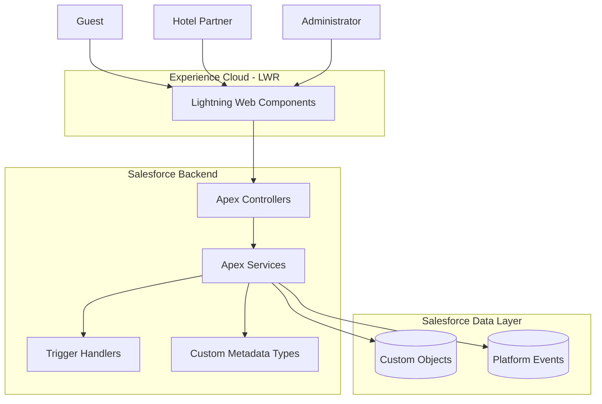

<p align="center">
  
</p>

<p align="center">
  <strong>A Salesforce-Powered Hotel Booking Platform</strong>
  <br/>
  Discover hotels, explore rooms, and manage bookings through one unified experience.
</p>

<p align="center">
  
  
  
  
  
</p>

---

## 🌐 About StayHub

**StayHub** is a Salesforce-based hotel booking platform designed to connect guests, hotel partners, and administrators through a unified reservation experience.

The platform enables guests to discover hotels, search available rooms, make reservations, manage bookings, and share reviews.

Hotel partners can manage their properties, room inventory, pricing, and availability, while administrators oversee platform operations.

Our goal is to build a scalable, secure, and user-friendly hotel booking ecosystem using the Salesforce platform.

## ✨ Key Features

| Feature               | Description                                            |
| --------------------- | ------------------------------------------------------ |
| 🔍 Hotel Discovery    | Search hotels by city, dates, and guest count.         |
| 🎯 Smart Filters      | Filter hotels by price, rating, and amenities.         |
| 🏨 Hotel Details      | Explore hotel information, room types, and reviews.    |
| 📅 Room Booking       | Reserve available rooms with booking validation.       |
| ❌ Cancellation       | Manage and cancel existing reservations.               |
| 💰 Dynamic Pricing    | Apply seasonal rates, discounts, and taxes.            |
| 💳 Payment Processing | Integrate payment processing and transaction tracking. |
| ⭐ Reviews & Ratings  | Allow guests to submit hotel feedback.                 |
| 🏢 Partner Management | Enable partners to manage properties and inventory.    |
| 📩 Lead Capture       | Capture and manage potential customer enquiries.       |

## 👥 User Roles

| Role             | Capabilities                                                          |
| ---------------- | --------------------------------------------------------------------- |
| 🧳 Guest         | Discover hotels, book rooms, cancel reservations, and submit reviews. |
| 🏢 Hotel Partner | Manage hotels, room types, rooms, rates, and availability.            |
| 🛡️ Administrator | Oversee platform operations, users, bookings, and configurations.     |

## 🛠️ Technology Stack

| Technology               | Purpose                        |
| ------------------------ | ------------------------------ |
| Salesforce Platform      | Application foundation         |
| Apex                     | Backend business logic         |
| Lightning Web Components | User interface                 |
| Experience Cloud (LWR)   | Customer-facing application    |
| Custom Metadata Types    | Rate plans and booking rules   |
| Salesforce DevOps Center | Deployment management          |
| Git & GitHub             | Version control                |
| GitHub Actions           | Automated validation and CI/CD |

## 🏗️ Application Architecture



## 🗄️ Salesforce Data Model

The initial data model consists of six primary custom objects:

| Object         | Purpose                                 |
| -------------- | --------------------------------------- |
| `Hotel__c`     | Stores hotel information and details.   |
| `Room_Type__c` | Defines room categories and capacities. |
| `Room__c`      | Maintains individual room information.  |
| `Booking__c`   | Manages guest reservations.             |
| `Payment__c`   | Tracks payment transactions.            |
| `Review__c`    | Stores guest reviews and ratings.       |

**Custom Metadata Types**

- `Rate_Plan__mdt` – Seasonal pricing, discounts, and tax configurations.
- `Booking_Rule__mdt` – Booking restrictions and cancellation policies.

## 📁 Project Structure

```text
StayHub/
│
├── config/
├── force-app/
│   └── main/
│       └── default/
│           ├── classes/
│           ├── lwc/
│           ├── objects/
│           ├── triggers/
│           └── applications/
│
├── manifest/
├── scripts/
│
├── docs/
│   ├── adr/
│   ├── wireframes/
│   ├── success-criteria.md
│   ├── user-stories.md
│   └── design.md
│
├── .github/
│   └── workflows/
│
├── .forceignore
├── sfdx-project.json
└── README.md
```

## 🚀 Development Roadmap

| Timeline | Milestone     | Focus                                                     |
| -------- | ------------- | --------------------------------------------------------- |
| Week 1   | 📝 Planning   | Requirements, architecture, wireframes, and DevOps setup  |
| Week 2   | 🗄️ Foundation | Salesforce objects, relationships, metadata, and security |
| Week 3   | ⚙️ Backend    | Apex services, booking logic, pricing, and integrations   |
| Week 4   | 🎨 Frontend   | Experience Cloud, LWC components, and checkout            |
| Week 5   | 🚢 Delivery   | UAT, regression testing, deployment, and handover         |

## 🧪 Quality Standards

| Metric                          | Target                        |
| ------------------------------- | ----------------------------- |
| Apex Test Coverage              | ≥ 90%                         |
| Critical Code Analyzer Findings | 0                             |
| Hotel Search Response Time      | < 2 seconds on 50,000 records |
| Booking Conflict Validation     | Required                      |
| Apex Bulkification              | Required                      |
| Security and Access Control     | Required                      |
| Deployment Validation           | Required                      |

## 🔄 Development & Deployment

StayHub follows a structured development and deployment process.

```text
Development
     ↓
GitHub Pull Request
     ↓
Code Review & Automated Validation
     ↓
Staging
     ↓
UAT
     ↓
Production
```

Salesforce DevOps Center and GitHub Actions will be used to manage deployments, automate validation, and maintain code quality.

## 📚 Documentation

Project documentation is maintained under the `docs/` directory.

- Success Criteria
- User Stories and Acceptance Criteria
- Database Design and ERD
- Security and Sharing Model
- Architecture Decision Records
- UI Wireframes
- Deployment Guide

## 📌 Project Status

<p>
  
  
</p>

StayHub is currently in its initial requirements and architecture phase.

---

<p align="center">
  <strong>StayHub – Your Stay. Your Way.</strong>
  <br/>
  Built on Salesforce. Designed for seamless stays.
</p>
