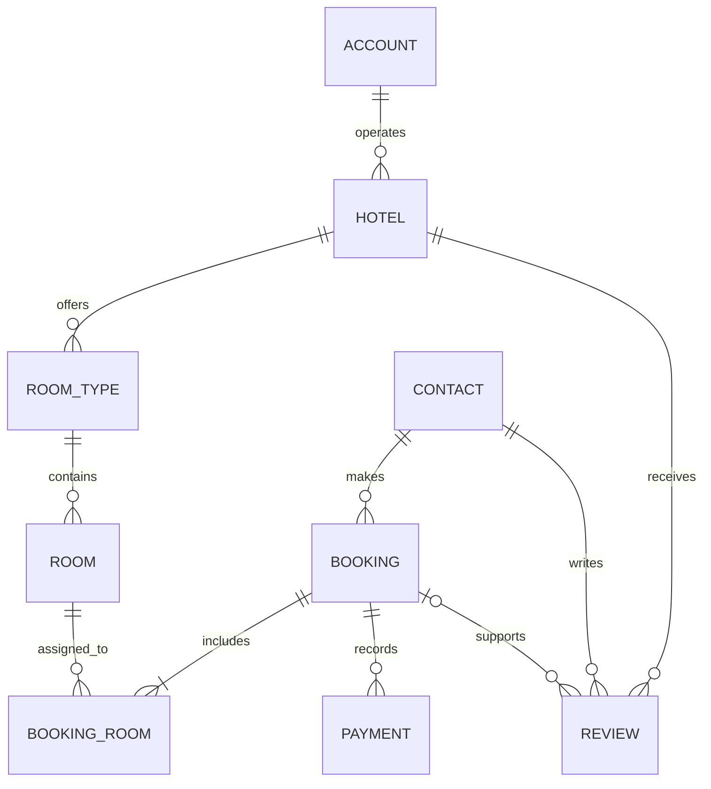

# StayHub — Data Model Specification

| Attribute | Details |
|---|---|
| Project | StayHub |
| Document | Data Model Specification |
| Version | 1.0 |
| Status | Proposed — Pending Review |
| Last Updated | November 3, 2026 |

---

## 1. Purpose

This document defines the Salesforce data model for StayHub, a hotel booking application.

It describes the standard and custom objects, field definitions, relationships, and business rules required to support:

- Hotel and partner management.
- Room type and room inventory management.
- Single-room and multiple-room reservations.
- Guest and booking management.
- Payment and refund tracking.
- Hotel reviews and ratings.

The proposed architecture supports implementation using Salesforce configuration, Apex, Lightning Web Components (LWC), and automation.

## 2. Object Inventory

### Standard Salesforce Objects

| Object | Purpose |
|---|---|
| Account | Hotel partner or operating organization |
| Contact | Guest information |

### Custom Salesforce Objects

| Object Label | API Name | Purpose |
|---|---|---|
| Hotel | `Hotel__c` | Hotel details and status |
| Room Type | `Room_Type__c` | Room categories and pricing |
| Room | `Room__c` | Individual physical rooms |
| Booking | `Booking__c` | Main reservation record |
| Booking Room | `Booking_Room__c` | Individual rooms within a reservation |
| Payment | `Payment__c` | Payments and refunds |
| Review | `Review__c` | Guest feedback and ratings |

## 3. Object Definitions

<details>
<summary><strong>1. Account — Hotel Partner</strong></summary>

**Object Type:** Standard Salesforce Object

**Purpose:** Represents a hotel partner or operating organization.

| Field | Data Type | Required |
|---|---|---|
| Name | Standard Name | Yes |
| Type | Picklist | No |

**Relationships:**

- One Account can operate multiple Hotels.
- Hotel references Account through `Partner_Account__c`.

</details>

<details>
<summary><strong>2. Contact — Guest</strong></summary>

**Object Type:** Standard Salesforce Object

**Purpose:** Stores guest information.

| Field | Data Type | Required |
|---|---|---|
| FirstName | Text | No |
| LastName | Text | Yes |
| Email | Email | No |
| Phone | Phone | No |

**Relationships:**

- One Contact can have multiple Bookings.
- One Contact can submit multiple Reviews.

</details>

<details>
<summary><strong>3. Hotel — Hotel__c</strong></summary>

**Object Type:** Custom Salesforce Object

**Purpose:** Stores hotel information, location, partner association, and operating status.

| Field API Name | Data Type | Required |
|---|---|---|
| Name | Text (80) | Yes |
| Hotel_Code__c | Auto Number | Yes |
| Partner_Account__c | Lookup(Account) | Yes |
| Description__c | Long Text Area | No |
| Phone__c | Phone | No |
| Email__c | Email | No |
| Street__c | Text (255) | Yes |
| City__c | Text (100) | Yes |
| State__c | Text (100) | Yes |
| Country__c | Text (100) | Yes |
| Postal_Code__c | Text (20) | No |
| Star_Rating__c | Number (1,0) | No |
| Status__c | Picklist | Yes |
| Check_In_Time__c | Time | No |
| Check_Out_Time__c | Time | No |

**Status values:**
- Draft
- Active
- Inactive
- Suspended

**Relationships:**

- Account → Hotel: Lookup.
- Hotel → Room Type: Master-Detail.
- Hotel → Review: Lookup.

**Design notes:**

- One partner Account can operate multiple hotels.
- Star rating should be restricted to 1–5.
- Room numbers must be unique within the same hotel.

</details>

<details>
<summary><strong>4. Room Type — Room_Type__c</strong></summary>

**Object Type:** Custom Salesforce Object

**Purpose:** Defines different room categories offered by a hotel.

| Field API Name | Data Type | Required |
|---|---|---|
| Name | Text (80) | Yes |
| Hotel__c | Master-Detail(Hotel__c) | Yes |
| Description__c | Long Text Area | No |
| Base_Price__c | Currency (16,2) | Yes |
| Max_Occupancy__c | Number (3,0) | Yes |
| Bed_Type__c | Picklist | No |
| Room_Size__c | Number (8,2) | No |
| Amenities__c | Long Text Area | No |
| Status__c | Picklist | Yes |

**Status values:**
- Active
- Inactive

**Relationships:**

- Hotel → Room Type: Master-Detail.
- Room Type → Room: Master-Detail.

**Design notes:**

- A hotel can offer multiple room types.
- Each room type belongs to one hotel.
- Each room type can contain multiple physical rooms.
- Base price represents the current catalogue price.

</details>

<details>
<summary><strong>5. Room — Room__c</strong></summary>

**Object Type:** Custom Salesforce Object

**Purpose:** Represents an individual physical room belonging to a room type.

| Field API Name | Data Type | Required |
|---|---|---|
| Name | Text (80) | Yes |
| Room_Number__c | Text (20) | Yes |
| Room_Type__c | Master-Detail(Room_Type__c) | Yes |
| Floor__c | Number (3,0) | No |
| Status__c | Picklist | Yes |
| Notes__c | Long Text Area | No |

**Status values:**
- Available
- Maintenance
- Inactive

**Relationships:**

- Room Type → Room: Master-Detail.
- Room → Booking Room: Lookup.

**Design notes:**

- Each physical room belongs to one room type.
- Room numbers should be unique within the same hotel.
- Availability must be calculated using reservation dates and existing bookings.
- A room marked Available is not necessarily available for every requested date range.

</details>

<details>
<summary><strong>6. Booking — Booking__c</strong></summary>

**Object Type:** Custom Salesforce Object

**Purpose:** Represents the main reservation made by a guest.

A single booking can contain multiple rooms.

| Field API Name | Data Type | Required |
|---|---|---|
| Name | Auto Number (BK-{00000}) | Yes |
| Guest__c | Lookup(Contact) | Yes |
| Check_In_Date__c | Date | Yes |
| Check_Out_Date__c | Date | Yes |
| Booking_Date__c | Date/Time | Yes |
| Status__c | Picklist | Yes |
| Total_Amount__c | Roll-Up Summary (SUM) | Yes |
| Special_Requests__c | Long Text Area | No |
| Number_of_Adults__c | Number (3,0) | Yes |
| Number_of_Children__c | Number (3,0) | No |
| Booking_Source__c | Picklist | No |

**Status values:**
- Draft
- Pending
- Confirmed
- Checked In
- Completed
- Cancelled

**Booking source values:**
- Website
- Mobile App
- Admin

**Relationships:**

- Contact → Booking: Lookup.
- Booking → Booking Room: Master-Detail.
- Booking → Payment: Lookup.
- Booking → Review: Lookup.

**Design notes:**

- Each booking belongs to one guest.
- A booking can contain multiple Booking Room records.
- Check-in and check-out dates are shared across all rooms in the booking.
- Total amount is calculated from associated Booking Room records.
- A confirmed booking must contain at least one Booking Room record.

</details>

<details>
<summary><strong>7. Booking Room — Booking_Room__c</strong></summary>

**Object Type:** Custom Salesforce Object

**Purpose:** Represents an individual room included in a booking.

This object enables multiple rooms to be reserved under a single booking.

| Field API Name | Data Type | Required |
|---|---|---|
| Name | Auto Number (BR-{00000}) | Yes |
| Booking__c | Master-Detail(Booking__c) | Yes |
| Room__c | Lookup(Room__c) | Yes |
| Adults__c | Number (3,0) | Yes |
| Children__c | Number (3,0) | No |
| Nightly_Rate__c | Currency (16,2) | Yes |
| Number_of_Nights__c | Formula (Number) | Yes |
| Room_Total__c | Formula (Currency) | Yes |

**Formula — Number of Nights:**

```salesforce
Booking__r.Check_Out_Date__c -
Booking__r.Check_In_Date__c
```

**Formula — Room Total:**

```salesforce
Nightly_Rate__c * Number_of_Nights__c
```

**Relationships:**

- Booking → Booking Room: Master-Detail.
- Room → Booking Room: Lookup.

**Design notes:**

- One booking can have multiple Booking Room records.
- Each Booking Room references one physical room.
- Each room can have its own guest allocation and nightly rate.
- Nightly rate is stored on Booking Room to preserve the agreed historical price.
- Booking total is calculated by summing all related room totals.

</details>

<details>
<summary><strong>8. Payment — Payment__c</strong></summary>

**Object Type:** Custom Salesforce Object

**Purpose:** Tracks payment transactions and refunds associated with a booking.

| Field API Name | Data Type | Required |
|---|---|---|
| Name | Auto Number (PAY-{00000}) | Yes |
| Booking__c | Lookup(Booking__c) | Yes |
| Amount__c | Currency (16,2) | Yes |
| Payment_Date__c | Date/Time | No |
| Payment_Method__c | Picklist | Yes |
| Payment_Status__c | Picklist | Yes |
| Transaction_Reference__c | Text (100), External ID, Unique | No |
| Payment_Type__c | Picklist | Yes |

**Payment method values:**
- Card
- UPI
- Net Banking
- Cash
- Wallet

**Payment status values:**
- Initiated
- Successful
- Failed
- Refunded
- Partially Refunded

**Payment type values:**
- Payment
- Refund

**Relationships:**

- Booking → Payment: Lookup.

**Design notes:**

- A booking can have multiple payment records.
- Payment records can represent partial payments and refunds.
- Booking is related through Lookup rather than Master-Detail.
- This avoids automatic cascade deletion of financial records when a booking is deleted.
- Transaction reference should be populated by the payment gateway when available.

</details>

<details>
<summary><strong>9. Review — Review__c</strong></summary>

**Object Type:** Custom Salesforce Object

**Purpose:** Stores guest ratings and feedback for hotels.

| Field API Name | Data Type | Required |
|---|---|---|
| Name | Auto Number (REV-{00000}) | Yes |
| Hotel__c | Lookup(Hotel__c) | Yes |
| Guest__c | Lookup(Contact) | Yes |
| Booking__c | Lookup(Booking__c) | No |
| Rating__c | Number (1,0) | Yes |
| Comments__c | Long Text Area | No |
| Review_Date__c | Date/Time | Yes |
| Status__c | Picklist | Yes |

**Status values:**
- Pending Moderation
- Published
- Rejected

**Relationships:**

- Hotel → Review: Lookup.
- Contact → Review: Lookup.
- Booking → Review: Lookup.

**Design notes:**

- A guest can submit feedback for a hotel.
- A review may reference the booking that qualifies the guest to review the hotel.
- Only guests with a completed booking at the relevant hotel should be eligible to submit reviews.
- Duplicate reviews for the same booking should be prevented.
- Rating should be restricted to values from 1 to 5.

</details>

## 4. Entity Relationship Diagram

The following diagram represents the logical relationships between StayHub objects.



## 5. Relationship Definitions

| Parent Object | Child Object | Relationship Type | Field |
|---|---|---|---|
| Account | Hotel | Lookup | Partner_Account__c |
| Hotel | Room Type | Master-Detail | Hotel__c |
| Room Type | Room | Master-Detail | Room_Type__c |
| Contact | Booking | Lookup | Guest__c |
| Booking | Booking Room | Master-Detail | Booking__c |
| Room | Booking Room | Lookup | Room__c |
| Booking | Payment | Lookup | Booking__c |
| Contact | Review | Lookup | Guest__c |
| Hotel | Review | Lookup | Hotel__c |
| Booking | Review | Lookup | Booking__c |

## 6. Business Rules and Data Integrity

| Rule ID | Business Rule | Expected Behavior |
|---|---|---|
| BR-001 | Valid booking dates | Check-out date must be later than check-in date. |
| BR-002 | Room availability | A room cannot be assigned to overlapping active bookings. |
| BR-003 | Room capacity | Assigned guests cannot exceed the room type's maximum occupancy. |
| BR-004 | Booking total | Booking total must equal the sum of all associated room totals. |
| BR-005 | Payment validation | Payment and refund amounts must be positive and associated with a booking. |
| BR-006 | Review eligibility | Only guests with a completed booking at the hotel can submit reviews. |
| BR-007 | Room numbering | Room number must be unique within its hotel. |
| BR-008 | Room status | Maintenance and inactive rooms cannot be booked. |
| BR-009 | Booking contents | A confirmed booking must contain at least one Booking Room record. |
| BR-010 | Review duplication | A booking should not receive duplicate reviews from the same guest. |
| BR-011 | Rating validation | Ratings must be within the defined 1–5 range. |

## 7. Technical Design Considerations

### 7.1 Multi-Room Reservations

Booking acts as the reservation header, while Booking Room stores each individual room assignment.

This supports multiple rooms under one reservation without creating separate booking records for every room.

### 7.2 Historical Pricing

The agreed nightly rate is stored on Booking Room rather than relying on the current Room Type base price.

This preserves the original booking price even if the hotel changes its pricing later.

### 7.3 Room Availability

Room availability must be calculated using reservation dates and existing bookings.

Apex will be responsible for checking date overlaps and preventing conflicting reservations.

### 7.4 Payment Auditability

Payment is maintained as a separate object with a Lookup relationship to Booking.

This supports payment history, partial payments, refunds, and transaction tracking.

### 7.5 Roll-Up Calculations

Booking uses a Roll-Up Summary field to calculate the total amount from its related Booking Room records.

### 7.6 Review Validation

Review eligibility and duplicate prevention should be enforced through server-side validation and business logic.

### 7.7 Data Security

Object permissions, field-level security, and record-level sharing will be documented separately in the Sharing Model.

## 8. Assumptions and Open Design Decisions

1. Each booking represents one guest reservation for one hotel.
2. All rooms within a booking share the same check-in and check-out dates.
3. Each Booking Room record represents one physical room.
4. A booking can contain multiple Booking Room records.
5. Each Booking Room has its own guest allocation and agreed nightly rate.
6. Payment records can represent partial payments and refunds.
7. Reviews may optionally reference the booking that qualifies the guest to review the hotel.
8. Taxes, discounts, service fees, cancellation charges, and payment gateway integration details require further design.
9. The initial model assumes one physical room per Booking Room record.

## 9. Scope Boundaries

This document defines the proposed logical and Salesforce object model.

The following areas will be addressed separately:

- Record-level sharing rules and role hierarchy.
- Permission sets and profiles.
- Apex implementation details.
- Lightning Web Component wireframes.
- Integration architecture.
- Deployment and release procedures.

## 10. Review and Approval

| Review Item | Status |
|---|---|
| Object inventory | Proposed |
| Field definitions | Proposed |
| Relationship design | Proposed |
| Multi-room booking support | Included |
| Business rules | Proposed |
| Technical review | Pending |
| Lead approval | Pending |

---

**Document Owner:** StayHub Development Team  
**Document Status:** Proposed — Pending Technical Review and Lead Approval
