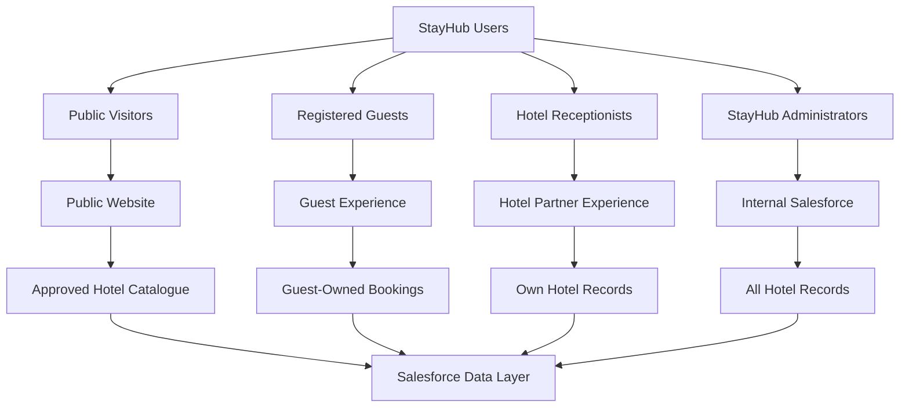

<p align="center">
  
</p>

<div align="center">

<h1>Sharing Model & Security Design</h1>

</div>

---

**Document:** Sharing Model  
**Project:** StayHub  
**Status:** Draft — Pending Technical Review  
**Version:** 1.0

---

## 1. Purpose

This document defines the Salesforce security and record-sharing architecture for StayHub.

The objective is to ensure that:

- Guests can access only their own booking-related information.
- Hotel receptionists can access records belonging to their hotel only.
- Public visitors can browse approved hotel and room information.
- StayHub administrators can access and manage records across all hotels.
- Sensitive guest and payment information remains protected.

## 2. User Categories

StayHub will support four categories of users.

### 2.1 Public Visitors

Unauthenticated users who visit the StayHub website.

**Permitted access:**

- Browse active hotels.
- View room types, amenities and publicly available prices.
- Check room availability.
- View approved hotel information.

**Restrictions:**

- Cannot view guest information.
- Cannot access booking records.
- Cannot access payment records.
- Cannot create or modify Salesforce records directly through unrestricted public access.

### 2.2 Registered Guests

Authenticated customers who register with StayHub.

**Permitted access:**

- View their own profile.
- Create bookings.
- View their own bookings.
- Cancel eligible bookings.
- View relevant payment information.
- Submit reviews for completed stays.

**Restrictions:**

- Cannot access another guest's bookings.
- Cannot access hotel operational records.
- Cannot modify payment transaction records.
- Cannot access internal administrative functionality.

### 2.3 Hotel Receptionists

External users who access StayHub through the Experience Cloud hotel-partner portal.

**Permitted access:**

- View their hotel's bookings.
- Create bookings on behalf of guests.
- Manage check-in and check-out operations.
- View room availability.
- Update room operational status.
- View relevant guest information.
- View payment status for their hotel's bookings.

**Restrictions:**

- Cannot access another hotel's records.
- Cannot access platform-wide administration.
- Cannot access unrelated guest records.
- Cannot modify sensitive financial transaction details.

Multiple receptionists may belong to the same hotel and share the same permitted hotel-level access.

A separate hotel manager role is outside the initial implementation scope.

### 2.4 StayHub Administrators

Internal Salesforce users responsible for platform administration.

**Permitted access:**

- Access records across all hotels.
- Manage hotel partner information.
- Manage hotel and room configurations.
- Monitor bookings and payments.
- Manage users and permissions.
- Review platform-wide operational information.

## 3. Security Architecture

StayHub will use Salesforce's standard security layers:

1. Organization-Wide Defaults (OWD).
2. Role hierarchy.
3. Profiles and Permission Sets.
4. Sharing Rules and Sharing Sets, where supported by the selected external-user license.
5. Field-Level Security (FLS).
6. Object-level permissions.
7. Apex sharing enforcement and application-level validation.

### 3.1 High-Level Architecture



## 4. Organization-Wide Defaults (OWD)

The initial design will use restrictive defaults for sensitive records.

| Object          | Proposed OWD         | Reason                                  |
| --------------- | -------------------- | --------------------------------------- |
| Account         | Private              | Restrict partner account access         |
| Contact         | Private              | Protect guest and user information      |
| Hotel__c        | Private              | Restrict hotel operational information  |
| Room_Type__c    | Private              | Restrict operational room configuration |
| Room__c         | Private              | Restrict room management                |
| Booking__c      | Private              | Protect guest booking information       |
| Booking_Room__c | Controlled by Parent | Inherit access from Booking             |
| Payment__c      | Private              | Protect financial records               |
| Review__c       | Private              | Restrict review management              |

**Public catalogue access:** Public visitors will receive only the required read access to approved hotel and room catalogue records through carefully configured guest-user sharing and application controls. Private OWD will not be replaced with public read/write access.

The exact OWD configuration must be verified against the selected Salesforce external-user license and Experience Cloud capabilities.

## 5. Role and Permission Design

### 5.1 Internal Users

| Role                 | Responsibility                               |
| -------------------- | -------------------------------------------- |
| System Administrator | Platform-wide administration                 |
| StayHub Operations   | Manage hotel and booking operations          |
| StayHub Support      | Assist guests and investigate booking issues |

The internal role hierarchy will be finalized based on actual staffing requirements.

### 5.2 External Users

| External User Category | Access Mechanism                                                         |
| ---------------------- | ------------------------------------------------------------------------ |
| Registered Guest       | Authenticated guest access with record-level ownership/sharing           |
| Hotel Receptionist     | Experience Cloud external user associated with the hotel partner Account |
| Public Visitor         | Experience Cloud guest-user access with restricted permissions           |

Receptionists belonging to the same hotel will be associated with the same partner Account.

## 6. Object-Level Access Matrix

Legend:

- **R** — Read
- **C** — Create
- **E** — Edit
- **D** — Delete
- **—** — No direct access

| Object          | Public Visitor      | Guest                 | Receptionist             | Administrator |
| --------------- | ------------------- | --------------------- | ------------------------ | ------------- |
| Account         | —                   | —                     | R                        | R/C/E/D       |
| Contact         | —                   | R/E own profile       | R limited                | R/C/E/D       |
| Hotel__c        | R approved          | R                     | R own hotel              | R/C/E/D       |
| Room_Type__c    | R approved          | R                     | R own hotel              | R/C/E/D       |
| Room__c         | R availability only | R availability only   | R/E own hotel            | R/C/E/D       |
| Booking__c      | —                   | R/C/E own             | R/C/E own hotel          | R/C/E/D       |
| Booking_Room__c | —                   | R own booking         | R/C/E own hotel          | R/C/E/D       |
| Payment__c      | —                   | R own payment details | R limited payment status | R/C/E/D       |
| Review__c       | R approved reviews  | R/C own review        | R own hotel reviews      | R/C/E/D       |

**Important:** This is the proposed application access matrix, not a direct Salesforce permission-set configuration. Object permissions, sharing, field-level security, Apex access and business rules must all be considered together.

## 7. Record-Level Sharing Strategy

### 7.1 Guest Record Access

Guest access will be restricted to records associated with the authenticated guest's Contact.

Expected relationships:

- Contact → Booking__c
- Booking__c → Booking_Room__c
- Booking__c → Payment__c
- Contact → Review__c

Access requirements:

1. Guests can view only bookings associated with their Contact.
2. Guests can view booking-room details through their accessible bookings.
3. Guests can view only their relevant payment information.
4. Guests can submit reviews only for eligible completed bookings.
5. Guests cannot change another guest's records by manipulating record IDs or URLs.

Possible implementation mechanisms include ownership, controlled sharing, Sharing Sets where supported, and Apex-managed sharing where necessary.

### 7.2 Hotel Receptionist Record Access

Each hotel will be associated with a partner Account.

Receptionists will be external users associated with that Account.

The intended access rule is:

**A receptionist can access only records belonging to the hotel associated with their external user Account.**

Proposed sharing mechanisms:

- Account-based external-user access.
- Sharing Sets where supported by the selected license and object relationships.
- Sharing Rules for supported internal sharing scenarios.
- Apex-managed sharing where standard sharing mechanisms cannot express the required relationship.

Receptionists belonging to the same hotel will share access to the hotel's permitted operational records.

### 7.3 Administrator Access

Internal administrators will have the permissions necessary to access and manage all StayHub records.

Administrative access will be granted through appropriately assigned profiles and Permission Sets.

## 8. Required Data Model Considerations

The current Data Model requires a few additional considerations before implementing external record sharing.

### 8.1 Booking-to-Hotel Relationship

The current Booking__c object does not have a direct Hotel__c relationship.

The hotel relationship currently flows through:

```text
Booking__c
    |
    | Master-Detail
    v
Booking_Room__c
    |
    | Lookup
    v
Room__c
    |
    | Master-Detail
    v
Room_Type__c
    |
    | Master-Detail
    v
Hotel__c
```

This indirect relationship can complicate external-user sharing.

**Recommendation:** Consider adding a direct Hotel__c Lookup field to Booking__c.

Validation must ensure that every room added to a booking belongs to the same hotel referenced by the booking.

This will simplify hotel-level sharing and improve reporting.

### 8.2 Guest Ownership and Identity

The Guest__c field on Booking__c references Contact.

Authenticated guest access must ensure that the logged-in user's Contact matches the Guest__c field.

A user must not be able to access another guest's records by changing a URL, record ID, or request parameter.

### 8.3 Payment Security

Payment__c records contain financial information.

- Guests can view only their own permitted payment information.
- Receptionists can view only the payment status and other operationally necessary fields.
- Sensitive payment details must not be exposed through the public website.
- Payment creation and updates should be controlled through trusted application logic.

## 9. Field-Level Security

Field-Level Security will be applied independently of record-level access.

Examples:

| Field Category                | Guest                   | Receptionist                  | Administrator |
| ----------------------------- | ----------------------- | ----------------------------- | ------------- |
| Guest personal information    | Own records             | Operationally required fields | As authorized |
| Booking amount                | Own booking             | Own hotel bookings            | Full access   |
| Payment transaction reference | Restricted              | Restricted                    | As authorized |
| Internal operational notes    | No                      | Limited                       | As authorized |
| Hotel configuration           | Read-only public fields | Own hotel fields              | Full access   |

Sensitive fields will not be exposed simply because a user has access to the parent record.

## 10. Apex and Lightning Web Component Security

All custom Apex controllers and services must enforce security.

Implementation requirements:

1. Use `with sharing` or an appropriate explicit sharing declaration.
2. Use user-mode database operations where appropriate.
3. Enforce object permissions and Field-Level Security.
4. Validate guest identity before retrieving or modifying bookings.
5. Validate hotel ownership before receptionist operations.
6. Avoid trusting record IDs received from the client.
7. Prevent unauthorized updates to payment and booking information.
8. Apply bulkification and governor-limit best practices.
9. Protect guest-facing APIs and public endpoints against unauthorized access.

Lightning Web Components must not rely only on hidden buttons or client-side checks for security.

## 11. Public Guest User Security

Public visitors will access only the approved hotel catalogue and availability functionality.

Security controls:

- Guest-user profile receives minimal object permissions.
- Guest-user sharing rules expose only approved public catalogue records.
- No public access to Booking__c or Payment__c.
- No public access to guest Contact information.
- Booking creation must use trusted server-side validation.
- Public endpoints must not disclose private record IDs or sensitive information.
- Availability results must not expose other guests' booking details.

Public guest access must be tested independently from authenticated guest access.

## 12. Security Validation and Test Scenarios

The following scenarios will be used to validate the security design.

| ID      | Test Scenario                                           | Expected Result                       |
| ------- | ------------------------------------------------------- | ------------------------------------- |
| SEC-001 | Public visitor views active hotels                      | Approved hotel information is visible |
| SEC-002 | Public visitor attempts to access a booking             | Access denied                         |
| SEC-003 | Guest views their own booking                           | Access granted                        |
| SEC-004 | Guest attempts to access another guest's booking        | Access denied                         |
| SEC-005 | Guest attempts to view another guest's payment          | Access denied                         |
| SEC-006 | Receptionist views their hotel's bookings               | Access granted                        |
| SEC-007 | Receptionist attempts to access another hotel's booking | Access denied                         |
| SEC-008 | Receptionist updates their hotel's room status          | Access granted                        |
| SEC-009 | Receptionist attempts to update another hotel's room    | Access denied                         |
| SEC-010 | Receptionist accesses restricted payment fields         | Access denied                         |
| SEC-011 | Administrator views records across hotels               | Access granted                        |
| SEC-012 | Unauthorized user attempts restricted field access      | Access denied                         |

## 13. Implementation Dependencies

The following items must be confirmed before final implementation:

1. Availability of suitable Experience Cloud licenses.
2. Whether the selected license supports the required external-user roles and sharing mechanisms.
3. Whether Sharing Sets can support the selected object relationships.
4. Whether direct Hotel__c relationships are required on Booking__c and other operational objects.
5. Guest registration and authentication approach.
6. Public catalogue and availability exposure strategy.
7. Payment integration and sensitive-data handling.
8. Internal administrator and support permission assignments.

## 14. Assumptions and Scope Boundaries

- Each hotel is represented by a separate partner Account.
- A hotel may have multiple receptionist users.
- All receptionists belonging to a hotel share the same hotel-level access.
- A separate hotel manager role is not included initially.
- Guests can register and authenticate to manage their bookings.
- Public visitors can browse approved hotel information without authentication.
- Internal StayHub administrators have platform-wide access.
- Public visitors and authenticated guests have separate security requirements.
- The exact external-user license and sharing implementation remain subject to validation.

## 15. Review and Approval

| Item                              | Status    |
| --------------------------------- | --------- |
| User categories defined           | Completed |
| Public visitor access defined     | Completed |
| Guest access defined              | Completed |
| Hotel receptionist access defined | Completed |
| Administrator access defined      | Completed |
| Proposed OWD documented           | Draft     |
| Sharing mechanisms documented     | Draft     |
| External-user license validation  | Pending   |
| Data model relationship review    | Pending   |
| Technical review                  | Pending   |
| Final approval                    | Pending   |

---

**Document status:** Draft — Ready for Technical Review

**Next design artifact:** Architecture Decision Records (ADRs)
