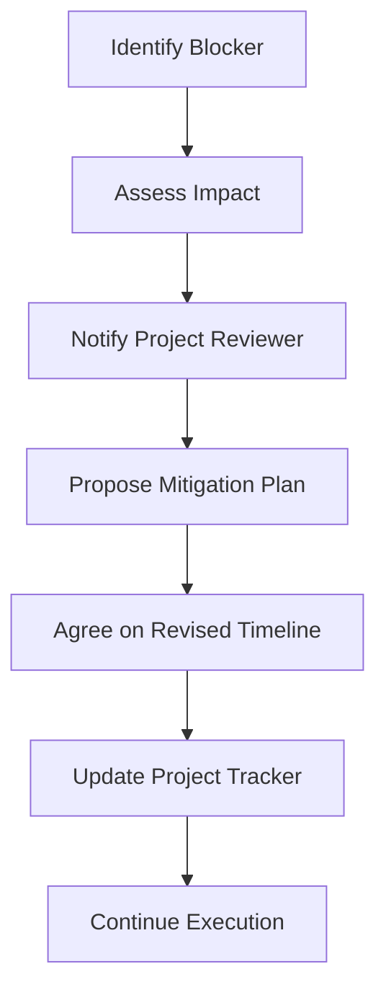

  

<h1>Project Success Criteria</h1>

<h2>Defining what success looks like, how it is measured, and how it is reviewed.</h2>

---

## 📌 Document Overview

| Property | Details |
|---|---|
| Project | StayHub |
| Document | Project Success Criteria |
| Version | 1.0 |
| Owner | Developer |
| Reviewer | To be assigned |
| Status | Draft – Pending Review |
| Development Timeline | 5 Weeks |

## 🧭 Quick Navigation

| Section | Description |
|---|---|
| [🎯 Project Deliverables](#-1-project-deliverables) | What we must deliver |
| [📊 Acceptance Criteria](#-2-passfail-acceptance-criteria) | How success is measured |
| [📅 Milestones](#-3-review-dates-and-milestones) | Project timeline and reviews |
| [🤝 Support](#-4-support-provided) | Required resources and dependencies |
| [🚨 Escalation](#-5-deadline-change-and-escalation-process) | Handling blockers and delays |
| [✅ Sign-off](#-acceptance-and-sign-off) | Final approval |

---

# 🎯 1. Project Deliverables

StayHub will deliver a Salesforce-based hotel booking application supporting three primary user groups:

<strong>👤 Guest Experience</strong>

- Hotel discovery and search
- Hotel search filters
- Hotel and room details
- Room availability
- Reservation creation
- Booking cancellation
- Guest reviews and ratings

<strong>🏨 Hotel Partner Experience</strong>

- Hotel registration and profile management
- Room type management
- Room inventory management
- Pricing management
- Booking monitoring

<strong>🛡️ Administrator Experience</strong>

- User and access management
- Booking oversight
- Hotel management oversight
- Operational reporting
- Platform monitoring

### 📦 Technical Deliverables

| # | Deliverable | Expected Outcome | Status |
|---:|---|---|---|
| 1 | Requirements Documentation | User stories and acceptance criteria | ⬜ Pending |
| 2 | Solution Architecture | ERD, security model and ADRs | ⬜ Pending |
| 3 | User Interface | Lightning Web Components | ⬜ Pending |
| 4 | Hotel Management | Hotel and room inventory management | ⬜ Pending |
| 5 | Booking Management | Booking creation and cancellation | ⬜ Pending |
| 6 | Automation | Apex and Salesforce Flows | ⬜ Pending |
| 7 | Security | Sharing, CRUD and FLS enforcement | ⬜ Pending |
| 8 | Testing | Apex and functional test coverage | ⬜ Pending |
| 9 | DevOps | GitHub integration and CI/CD | ⬜ Pending |
| 10 | Documentation | Technical and deployment documentation | ⬜ Pending |

---

# 📊 2. Pass/Fail Acceptance Criteria

The following metrics will be used to evaluate project quality.

<strong>⚙️ Technical Quality Targets</strong>

| Metric | Acceptance Target |
|---|---:|
| Apex test coverage | ≥ 90% |
| Critical Code Analyzer findings | 0 |
| SOQL queries inside loops | 0 |
| Hotel search response time (50,000 records) | Under 2 seconds |
| Unauthorized access to restricted records | 0 successful unauthorized accesses |
| Deployment validation | Successful |

<strong>🧪 Functional Acceptance Checklist</strong>

**Guest functionality**

- [ ] Guests can search for hotels.
- [ ] Guests can filter search results.
- [ ] Guests can view hotel and room details.
- [ ] Guests can create reservations.
- [ ] Guests can cancel eligible reservations.
- [ ] Guests can submit reviews.

**Hotel partner functionality**

- [ ] Partners can manage hotel information.
- [ ] Partners can manage room types.
- [ ] Partners can manage room inventory.
- [ ] Partners can monitor reservations.

**Administrator functionality**

- [ ] Administrators can oversee hotel operations.
- [ ] Administrators can manage platform access.
- [ ] Administrators can access authorized reports.

<strong>🔐 Security Acceptance Checklist</strong>

- [ ] Object-level permissions are enforced.
- [ ] Field-Level Security is respected.
- [ ] Record-level sharing is implemented.
- [ ] Apex sharing behavior is reviewed.
- [ ] Unauthorized access scenarios are tested.
- [ ] User roles and permissions are validated.

<strong>🧪 Testing Acceptance Checklist</strong>

- [ ] Positive test scenarios completed.
- [ ] Negative test scenarios completed.
- [ ] Boundary conditions tested.
- [ ] Bulk data scenarios tested.
- [ ] Apex unit tests executed.
- [ ] Lightning Web Component tests executed where applicable.
- [ ] Critical user journeys validated.

---

# 📅 3. Review Dates and Milestones

The project follows a five-week delivery plan.

| Milestone | Focus Area | Review Status |
|---|---|---|
| Week 1 | Requirements, architecture and DevOps | ⬜ Pending |
| Week 2 | Data model, security and foundational Apex | ⬜ Pending |
| Week 3 | Search, availability and booking | ⬜ Pending |
| Week 4 | Administration, partner management and dashboards | ⬜ Pending |
| Week 5 | Testing, optimization and deployment | ⬜ Pending |

### 📍 Milestone Review Checklist

<strong>Week 1 — Requirements and Design</strong>

- [ ] Success criteria documented.
- [ ] At least 12 user stories created.
- [ ] Acceptance criteria defined.
- [ ] ERD prepared.
- [ ] Security model documented.
- [ ] Three architecture decision records prepared.
- [ ] Four wireframes prepared.
- [ ] DevOps Center configured.
- [ ] GitHub Actions configured.

<strong>Week 2 — Core Setup</strong>

- [ ] Salesforce objects and fields configured.
- [ ] Relationships implemented.
- [ ] Permissions and sharing configured.
- [ ] Sample data prepared.
- [ ] Foundational Apex services implemented.
- [ ] Unit tests written.

<strong>Week 3 — Core Features</strong>

- [ ] Hotel search implemented.
- [ ] Search filters implemented.
- [ ] Hotel detail page implemented.
- [ ] Room availability implemented.
- [ ] Booking functionality implemented.
- [ ] Cancellation functionality implemented.

<strong>Week 4 — Administration</strong>

- [ ] Hotel partner functionality implemented.
- [ ] Administrative functionality implemented.
- [ ] Reports and dashboards developed.
- [ ] Security validation completed.

<strong>Week 5 — Quality and Deployment</strong>

- [ ] Apex testing completed.
- [ ] Bulkification validated.
- [ ] Code Analyzer executed.
- [ ] End-to-end testing completed.
- [ ] Defects resolved.
- [ ] Deployment pipeline validated.
- [ ] Final documentation completed.

**Review schedule:** Exact review dates are to be confirmed with the project reviewer.

---

# 🤝 4. Support Provided

The following resources and support are expected to facilitate successful project delivery.

| Support Area | Expected Support |
|---|---|
| Salesforce Environment | Developer Org and required environment access |
| Development Tools | VS Code, Salesforce CLI and GitHub |
| Requirements | Functional and technical clarification |
| Documentation | Access to project references |
| Reviews | Timely feedback on milestone deliverables |
| DevOps | Assistance with environment and deployment issues |

### Dependency Tracking

| Dependency | Impact | Status |
|---|---|---|
| Salesforce environment access | Development and deployment | ⬜ To verify |
| GitHub repository access | Source control | ⬜ To verify |
| Functional clarification | Requirements accuracy | ⬜ To verify |
| Reviewer availability | Milestone approvals | ⬜ To confirm |

---

# 🚨 5. Deadline Change and Escalation Process

If a deliverable is at risk of missing its planned deadline, the following process will be followed.

### Escalation Checklist

- [ ] Identify and document the blocker.
- [ ] Assess the impact on deliverables.
- [ ] Notify the project reviewer promptly.
- [ ] Propose a mitigation plan.
- [ ] Agree on a revised completion estimate.
- [ ] Obtain approval for deadline changes.
- [ ] Update the project tracker.

### Required Change Information

| Field | Description |
|---|---|
| Deliverable | Affected project task |
| Original Deadline | Previously agreed date |
| Reason | Blocker or dependency |
| Impact | Schedule or scope impact |
| Mitigation | Proposed corrective action |
| Revised Deadline | Proposed completion date |
| Approval | Reviewer confirmation |

---

# ✅ Acceptance and Sign-off

This document establishes the initial project success criteria and evaluation framework for StayHub.

| Role | Name | Approval Date | Status |
|---|---|---|---|
| Developer | To be assigned | Pending | ⬜ Pending |
| Project Reviewer | To be assigned | Pending | ⬜ Pending |

---

**StayHub — Your Stay. Your Way.**

*Clear requirements. Measurable outcomes. Quality delivery.*

