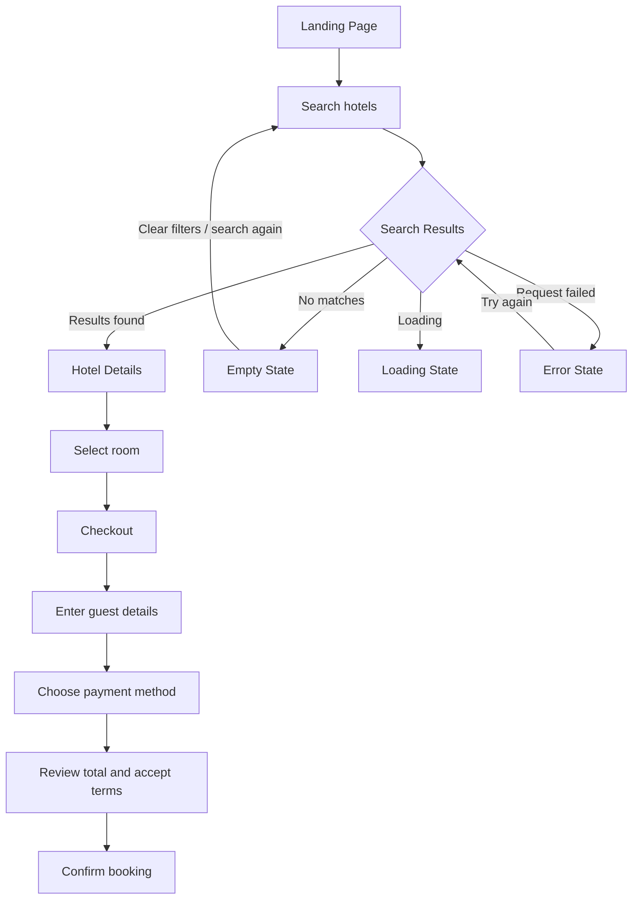
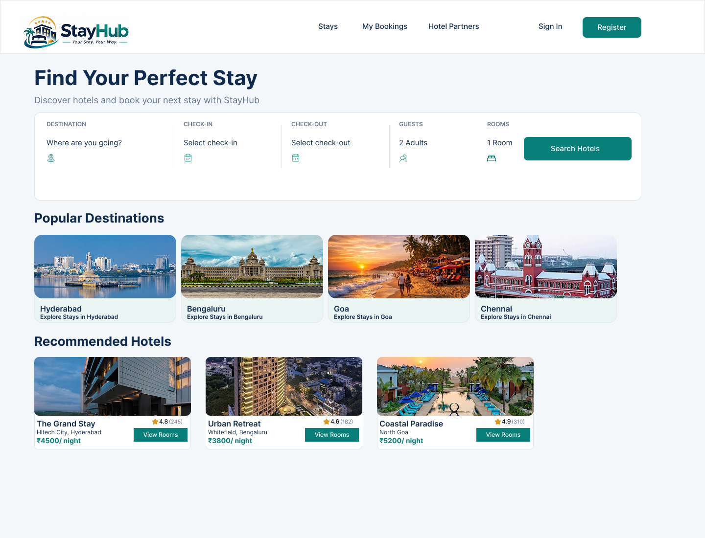
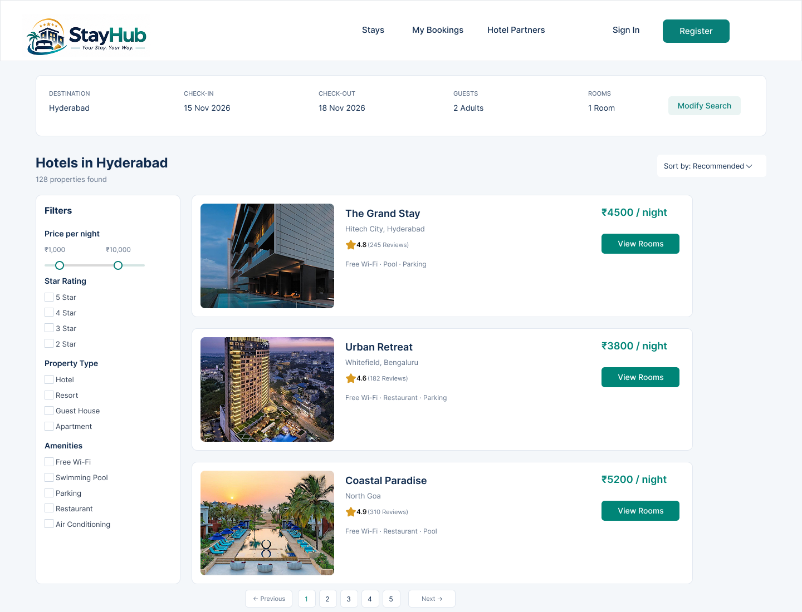
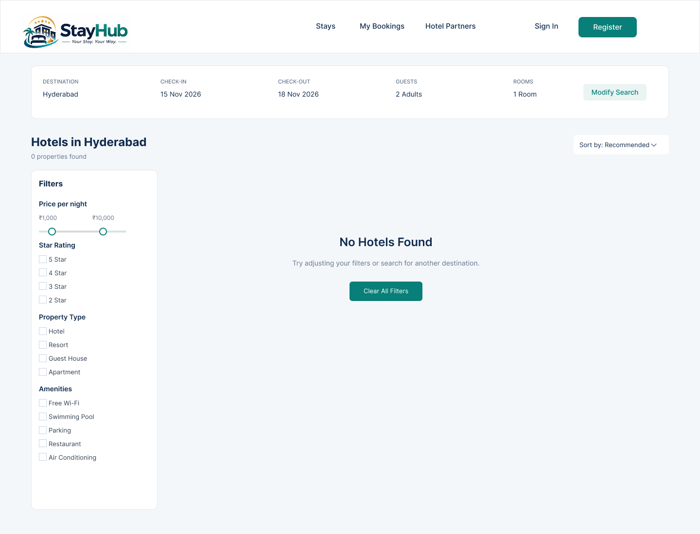
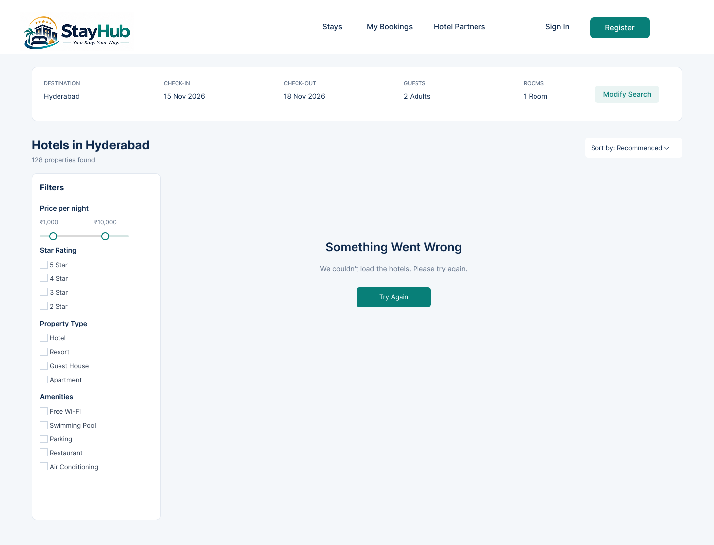
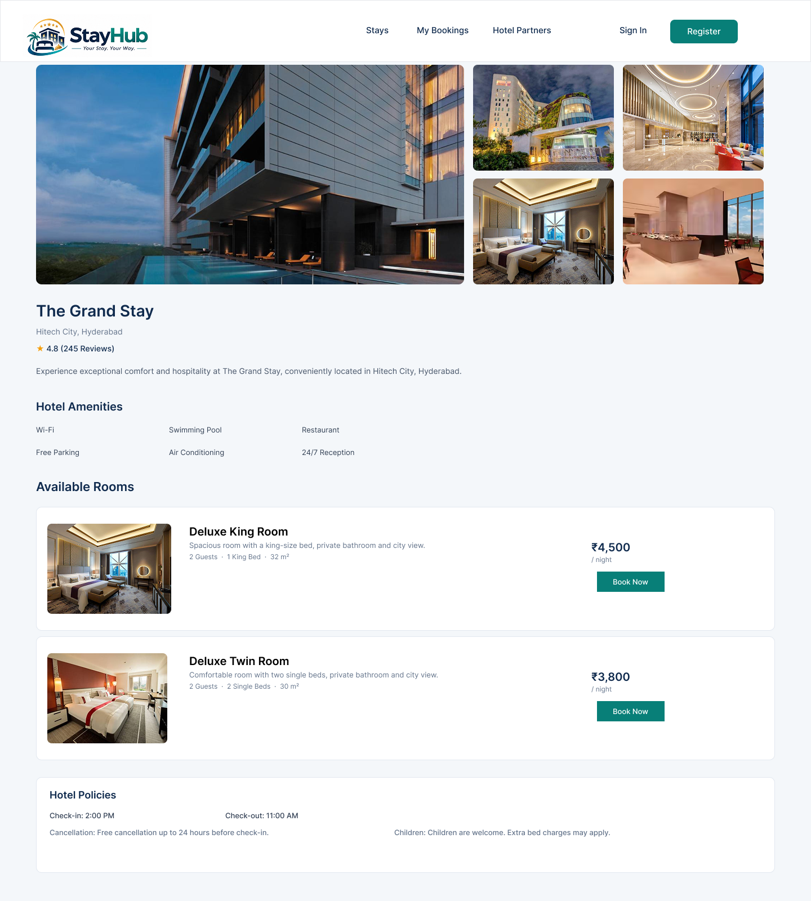
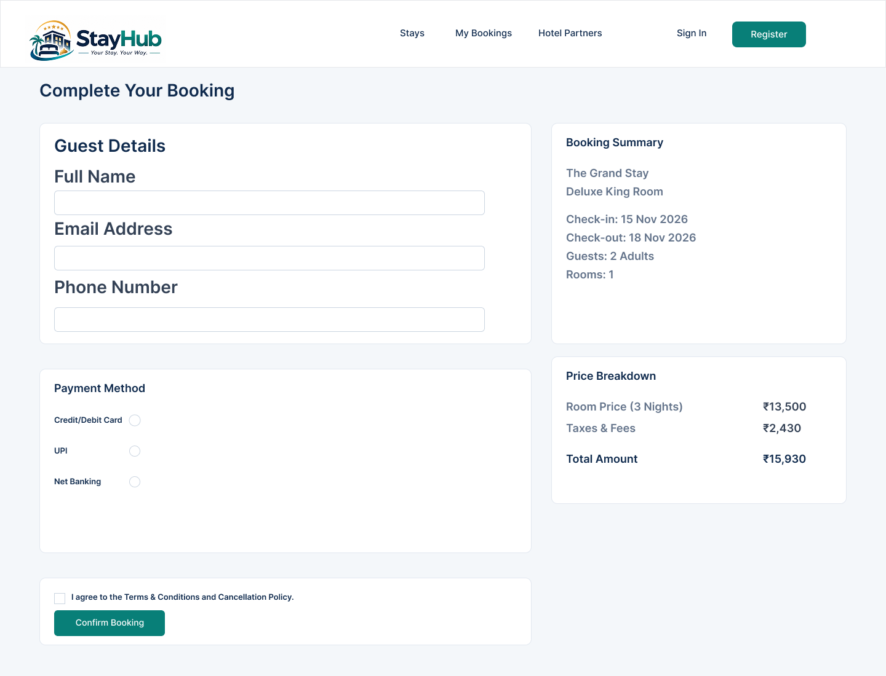

# StayHub --- UI Wireframes

> **Purpose:** Visual reference for the StayHub hotel-booking
> experience, from hotel discovery through booking confirmation.

[Overview](#overview) · [Customer journey](#customer-journey) · [Screens
and states](#screens-and-states) · [Interactions](#key-interactions) ·
[Design](#design-conventions)

## Overview

These wireframes document the primary customer-facing StayHub booking
flow. They describe page structure, information hierarchy, and intended
interaction points; they do not by themselves prove that the
corresponding application functionality has been implemented.

## Customer journey

## Screens and states

### 1. Landing Page

**Purpose:** Entry point for discovering accommodation.

-   StayHub header, navigation, and account actions.
-   Hero message and hotel search controls.
-   Popular destination cards.
-   Recommended hotel cards.

**Primary interaction:** Enter search criteria and select **Search
Hotels**.

### 2. Search Results --- Success

**Purpose:** Present hotels matching the submitted search.

-   Search summary: destination, dates, guests, and rooms.
-   Modify Search action, result count, and sorting.
-   Filters for price, star rating, property type, and amenities.
-   Hotel cards with rating, amenities, nightly price, and **View
    Rooms**.
-   Pagination.

**Primary interactions:** Refine filters, change sorting, modify search
criteria, or open a hotel.

### 3. Search Results --- Loading

**Purpose:** Communicate that hotel results are being retrieved.

Skeleton placeholders represent the image, title, description, price,
and action areas of result cards. They should be replaced by results
when loading completes.

### 4. Search Results --- Empty

**Purpose:** Explain that the current search returned no matching
hotels.

-   Result count: **0 properties found**.
-   Message: **No Hotels Found**.
-   Guidance to adjust filters or search another destination.
-   **Clear All Filters** action.

### 5. Search Results --- Error

**Purpose:** Explain that hotel results could not be loaded.

-   Message: **Something Went Wrong**.
-   Explanation that hotels could not be loaded.
-   **Try Again** action to retry retrieval.

### 6. Hotel Details

**Purpose:** Help the customer evaluate a hotel and choose a room.

-   Hotel image gallery.
-   Hotel name, location, rating, and description.
-   Hotel amenities.
-   Available room types with images, capacity, bed details, area,
    nightly price, and **Book Now** actions.
-   Check-in/check-out times and sample hotel policy information.

**Primary interaction:** Select **Book Now** for the preferred room to
proceed to checkout.

> **Content note:** Hotel names, prices, dates, ratings, and policy text
> shown in the wireframe are illustrative sample content. Verify real
> values and policies before using them in a live experience.

### 7. Checkout

**Purpose:** Collect guest and payment choices and present the booking
total before confirmation.

-   Guest Details: full name, email address, and phone number.
-   Booking Summary: hotel, room, check-in/check-out dates, guests, and
    room count.
-   Price Breakdown: room price, taxes and fees, and total amount.
-   Payment Method options: credit/debit card, UPI, and net banking.
-   Terms and cancellation-policy acknowledgement.
-   **Confirm Booking** action.

**Primary interaction:** Enter guest details, select a payment method,
review the amount, accept the terms, and select **Confirm Booking**.

**Design note:** The wireframe shows payment-method choices and a
confirmation area. It does not specify gateway behavior, card-entry
fields, payment authorization, or post-confirmation feedback.

## Key interactions

  -----------------------------------------------------------------------
  From                    Action                  To / expected outcome
  ----------------------- ----------------------- -----------------------
  Landing Page            Search Hotels           Search Results

  Search Results          Open a hotel / View     Hotel Details
                          Rooms                   

  Empty State             Clear All Filters       Search can be refined
                                                  again

  Error State             Try Again               Retry results retrieval

  Hotel Details           Book Now                Checkout

  Checkout                Confirm Booking         Booking confirmation
                                                  flow (not included in
                                                  this wireframe set)
  -----------------------------------------------------------------------

## Design conventions

  Token             Value       Usage
  ----------------- ----------- -------------------------------------
  Navy              `#102B4E`   Primary headings and key text
  Teal              `#087F78`   Primary actions and selected states
  Gold              `#D99A21`   Rating/star accent
  Page background   `#F4F7FA`   Main page canvas
  Soft teal         `#EAF4F3`   Highlighted sections
  Border            `#E2E8F0`   Card and input outlines
  Secondary text    `#64748B`   Supporting information
  Font              Inter       Typography

## Coverage checklist

-   [x] Landing Page
-   [x] Search Results --- Success
-   [x] Search Results --- Loading
-   [x] Search Results --- Empty
-   [x] Search Results --- Error
-   [x] Hotel Details
-   [x] Checkout

## Related documentation

-   [Success Criteria](../success-criteria.md)
-   [User Stories](../user-stories.md)
-   [Data Model](../data-model.md)
-   [Sharing Model](../sharing-model.md)
-   [Change Promotion Guide](../change-promotion-guide.md)
-   [Architecture Decision Records](../adr/)

------------------------------------------------------------------------

*Maintained as part of the StayHub project documentation. Update this
page when the wireframes or documented customer journey change.*
